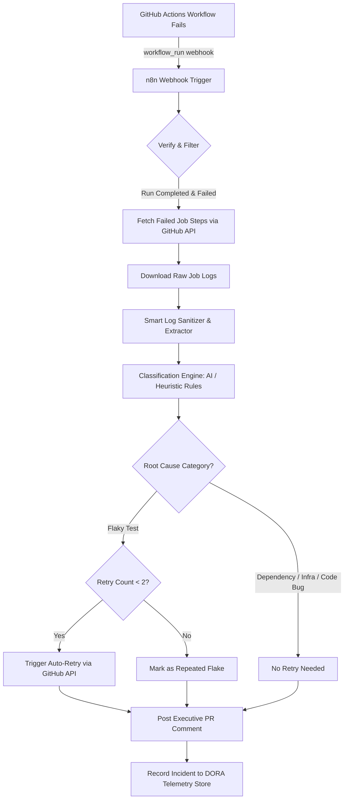

# 🔍 CI/CD Failure Analyzer

> **“Developers know why the build failed without reading 2,000 log lines.”**

An automated DevOps intelligence workflow powered by **n8n**, **GitHub Actions**, and **AI / Heuristic Pattern Matching**. Whenever a CI pipeline fails, this analyzer intercepts the failure webhook, extracts the culprit logs, classifies the root cause (flaky test, dependency outage, infrastructure failure, or real code bug), posts an executive summary directly to the Pull Request, and safely auto-retries flaky tests without human intervention.

---

## 🎯 The Problem & Value Proposition

- **The Problem:** Modern CI/CD pipelines generate thousands of lines of verbose logs. When a build breaks, developers waste 10–20 minutes parsing stack traces, guessing if it's their code or a transient flaky test, and manually re-triggering pipelines.
- **The Solution:** Instant triage within 5 seconds of failure. Developers get a crisp, 2-line root cause diagnosis and fix recommendation right on their PR.
- **The Savings:** Eliminates 70%+ of manual log inspection time and saves precious CI build minutes by retrying *only* when statistically justified.
- **Engineering Health:** Tracks flakiness metrics over time, feeding directly into **DORA metrics** (Change Failure Rate, Mean Time to Recovery).

---

## 🏗️ Architecture & Workflow



---

## 🏷️ Failure Classification Taxonomy

| Category | Typical Causes | Automated Action | Target Audience |
| :--- | :--- | :--- | :--- |
| 🧪 **Flaky Test** | Race condition, async hook timeout, port collision, mock leak | **Auto-retry job** (up to max attempts) & log flake signature | Test Author / QA |
| 📦 **Dependency Error** | npm/pip 404, registry network timeout, lockfile mismatch | Alert package mismatch; no retry if registry is down | DevOps / Dev |
| 🏗️ **Infrastructure** | Docker OOM (code 137), disk full, GitHub runner disconnect | Alert platform team; auto-retry if transient worker crash | Platform / SRE |
| 🐛 **Code Bug** | Unit assertion failure, syntax error, compiler failure | Direct link to failing source line; require code push | PR Author |

---

## 💬 Sample PR Comment Preview

When a build fails, the analyzer posts this formatted comment directly to the Pull Request:

> ### 🚨 CI Build Failure Analysis
> 
> **Run:** `#142` on commit `8f21bc9` | **Job:** `E2E Tests` | **Step:** `Run npm run test:e2e`  
> **Status:** 🧪 **Flaky Test Detected** (Confidence: `94%`)
> 
> ---
> 
> #### 📋 Root Cause Summary
> `tests/e2e/checkout-webhook.spec.ts` timed out after `10000ms` waiting for asynchronous event `charge.succeeded`. This is an intermittent network/race-condition signature.
> 
> #### 💡 Suggested Action
> Check webhook mock latency or increase timeout with `jest.setTimeout(15000)`.
> 
> #### ⚡ Automated Action Taken
> **Auto-retrying failed jobs now** (Attempt 1 of 2). You do not need to manually rerun this job.
> 
> <details>
> <summary><b>🔍 View Sanitized Log Snippet (Click to expand)</b></summary>
> 
> ```text
> FAIL tests/e2e/checkout-webhook.spec.ts (15.22s)
> ● Checkout Webhook Flow › should receive asynchronous charge.succeeded event
>   Timeout - Async callback was not invoked within the 10000 ms timeout specified by jest.setTimeout.
>     39 | const eventPromise = waitForWebhookEvent('charge.succeeded', { timeout: 10000 });
>   > 40 | await triggerSimulatedStripeCharge({ orderId: 'ord_9981' });
>        | ^
> ```
> </details>
> 
> *Automated by [n8n CI/CD Failure Analyzer](https://github.com/acme-corp/ci-failure-analyzer)*

---

## 🚀 Quickstart & Setup

### 1. Prerequisites
- Docker & Docker Compose **or** Node.js 18+ (to run n8n)
- A GitHub Personal Access Token (PAT) with:
  - `repo` (or fine-grained: `Actions: Read & Write`, `Pull Requests: Read & Write`)

### 2. Configure Environment
Copy the example environment file:
```bash
cp .env.example .env
```
Fill in:
- `GITHUB_TOKEN`: Your GitHub PAT.
- `WEBHOOK_URL`: Your public n8n URL (e.g. ngrok tunnel or domain).
- `OPENAI_API_KEY`: *(Optional)* For AI reasoning. If left empty, the built-in deterministic Heuristic Classifier handles classification with zero API cost!

### 3. Start n8n
#### Option A: Using Docker Compose
```bash
docker compose up -d
```
Access the n8n UI at `http://localhost:5678`.

#### Option B: Standalone using npx (No Docker required)
```bash
npx n8n
```

### 4. Import the Workflow
1. In the n8n web dashboard, navigate to **Workflows** -> **Import from File**.
2. Select [`workflows/ci-failure-analyzer.json`](workflows/ci-failure-analyzer.json).
3. Toggle the workflow to **Active**.

### 5. Setup the GitHub Webhook
In your target GitHub repository:
1. Go to **Settings** -> **Webhooks** -> **Add webhook**.
2. **Payload URL:** `https://<your-n8n-url>/webhook/github-ci-failure`
3. **Content type:** `application/json`
4. **Which events would you like to trigger this webhook?**
   - Select **Let me select individual events** -> check **Workflow runs**.
5. Save webhook.

---

## 🧪 Testing Locally (No Live GitHub Pipeline Required)

We provide sample test fixtures and a simulation CLI to test the analyzer immediately:

```bash
# Test the heuristic classifier against all 4 fixture logs:
node scripts/test-classifier.js

# Send a simulated GitHub workflow_run failure webhook to n8n:
node scripts/simulate-webhook.js --type flaky-test
node scripts/simulate-webhook.js --type code-bug
node scripts/simulate-webhook.js --type dependency-error
node scripts/simulate-webhook.js --type infra-failure
```

---

## 📊 DORA Metrics & ROI Telemetry

The workflow persists telemetry for each failure incident into a structured metrics log (`data/metrics.json`). You can inspect DORA impacts at any time:

```bash
node scripts/dora-metrics.js
```

### Metrics Tracked:
1. **Change Failure Rate (CFR):**
   $$\text{CFR} = \frac{\text{True Code Failures}}{\text{Total Production Deployments}}$$
   *Filtering out flaky tests prevents false degradation of your team's CFR!*
2. **Flakiness Ratio:**
   $$\text{Flakiness Ratio} = \frac{\text{Flaky Test Failures}}{\text{Total Pipeline Failures}}$$
3. **Developer Hours Saved:**
   $$\text{Hours Saved} = \text{Auto-retried Runs} \times 0.25\text{ hrs (15 min avg triage time)}$$

---

## 📂 Repository Structure

```
.
├── README.md                          # Comprehensive documentation & guide
├── .gitignore                         # Standard git ignore definitions
├── .env.example                       # Environment template
├── docker-compose.yml                 # Production-ready n8n setup
├── workflows/
│   ├── ci-failure-analyzer.json       # Importable n8n workflow definition
│   └── README.md                      # Detailed node configuration breakdown
├── scripts/
│   ├── simulate-webhook.js            # CLI tool to test webhook triggers
│   ├── test-classifier.js             # Standalone classifier test suite
│   └── dora-metrics.js                # DORA metrics calculator
├── tests/
│   └── fixtures/logs/                 # Real-world failure logs
│       ├── flaky-test.log             # Async timeout failure
│       ├── code-bug.log               # Vitest assertion failure
│       ├── dependency-error.log       # npm 404 registry missing
│       └── infra-failure.log          # Docker out of disk / exit 137
├── .github/
│   └── workflows/
│       ├── ci-sample.yml              # Sample multi-scenario pipeline
│       └── notify-n8n.yml             # Native GitHub Action caller
└── docs/
    └── pr-comment-preview.md          # Formatted PR comment reference
```

---

## 🛡️ Safety & Retry Guardrails

To prevent runaway retry storms and CI cost spikes:
- **Maximum Retries:** Capped at `2` attempts per workflow run.
- **Non-Retriable Failures:** `CODE_BUG` and persistent `DEPENDENCY_ERROR` never trigger auto-retries.
- **Idempotency:** Unique run IDs and commit hashes are tracked to prevent duplicate comments on the same PR.

---

## 📄 License
MIT License. Feel free to use and adapt in your engineering organization!
